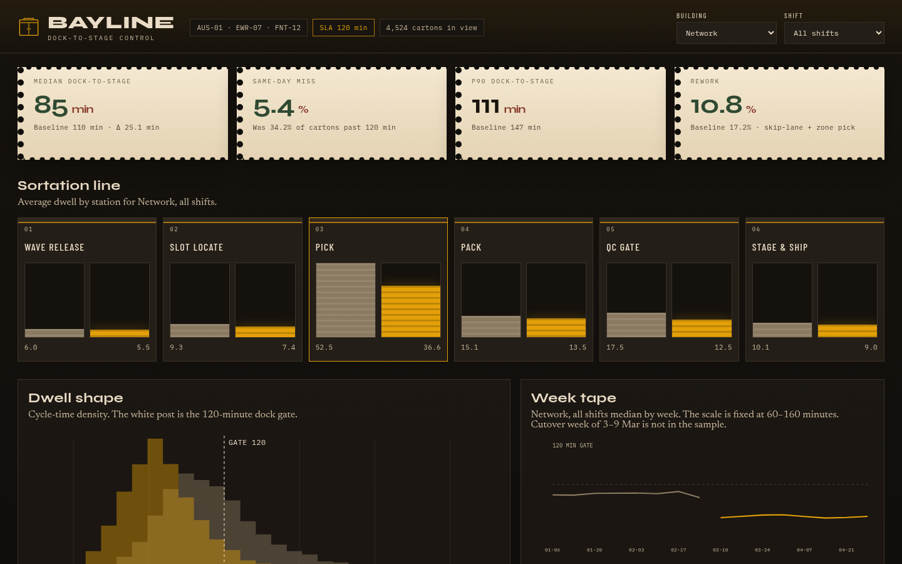
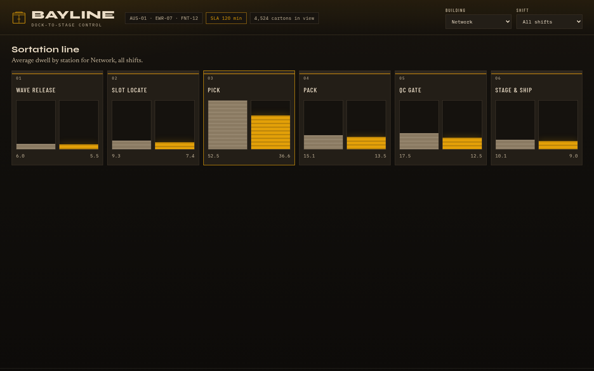
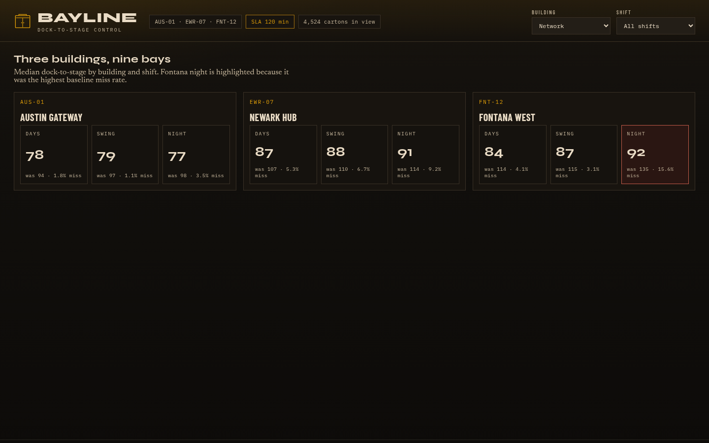
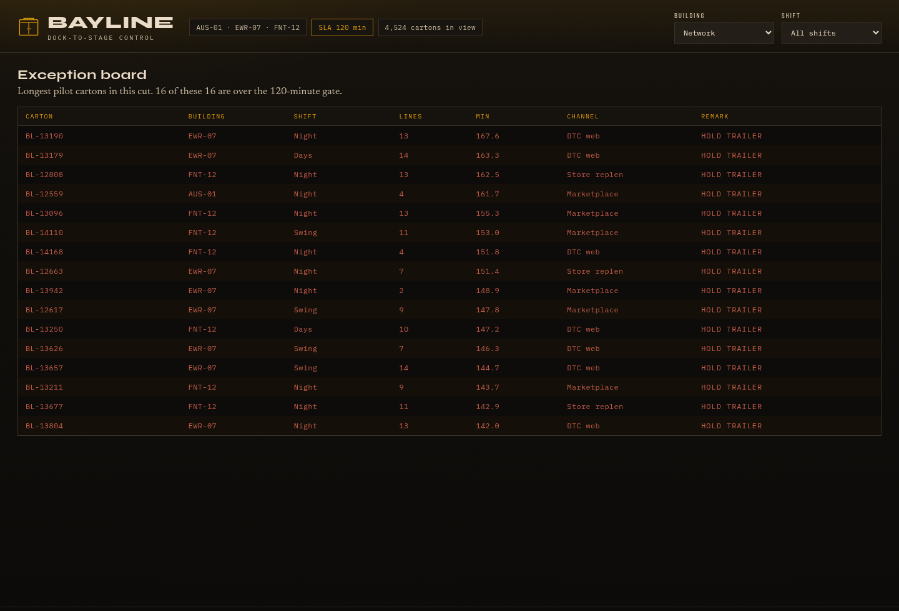
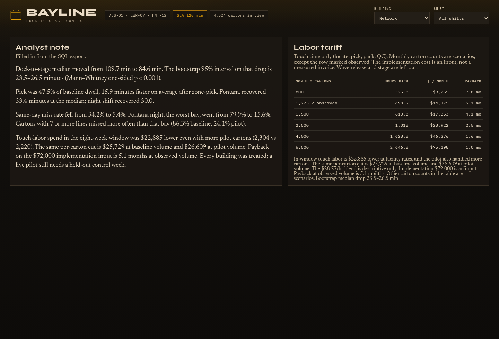

# Bayline

Simulated dock-to-stage cycle times for three buildings: Austin Gateway (AUS-01), Newark Hub (EWR-07), and Fontana West (FNT-12).

Orders, step dwell, and exceptions come from `python -m bayline` with seed 42. They are not a warehouse extract. Labor rates live on `dim_facility`. The $72,000 implementation cost is an input in `data/dim_assumption.csv`.

The same-day gate is 120 minutes from wave drop to stage. A cycle of exactly 120.0 minutes counts as on time. The pilot is zone-pick in every building, with the largest pick cut at Fontana, plus a QC skip-lane for low-risk 1–2 line DTC and marketplace cartons. Store replen and hazmat stay on the full QC gate. There is no untreated control. Austin's layout factor is 1.0, and the pilot runs in every building.

Demo site: [parbproject.github.io/E-commerce-Order-Fulfillment-Process-Improvement](https://parbproject.github.io/E-commerce-Order-Fulfillment-Process-Improvement/)



## Scorecard

Eight weeks of baseline, then eight weeks of pilot. These rows match `kpi_period`, `sla_cells`, and `dashboard/metrics.json`.

| | Baseline | Pilot |
|---|---:|---:|
| Cartons | 2,220 | 2,304 |
| Median dock-to-stage | 109.7 min | 84.6 min |
| P90 | 147.3 min | 111.4 min |
| Same-day miss (cycle > 120 min) | 34.2% | 5.4% |
| Fontana night miss | 79.9% | 15.6% |
| Rework | 17.2% | 10.8% |

The control board rounds the median and the P90 to the nearest minute (110, 85, 147, 111).

Pick was 47.5% of baseline average dwell. Cartons with 7 or more lines missed more often than Fontana night in the baseline (86.3%).

One-sided Mann–Whitney test (pilot cycle times smaller): p < 0.001. The two-sided p-value is also under 0.001. Bootstrap 95% interval on the median drop: 23.5–26.5 minutes. The median of that bootstrap is 25.1 minutes.









## Labor

Touch time is slot locate, pick, pack, and QC, priced at each building's own rate. Wave release and stage are not in the labor dollars. The order-weighted blend of the three rates is $28.27/hr. That blend is not used to price the dollars below.

In the 16-week window, touch-labor cost was $22,885 lower. The pilot also had more cartons, so this is not volume-matched. The same per-carton cut is $25,729 at the baseline mix and $26,609 at the pilot mix.

Payback uses the $72,000 input, holds the observed per-carton touch time, and scales the observed week to a 26-day month. That payback is 5.1 months. It is separate from the $22,885 window total.

The labor table on the board includes other monthly carton counts (800, 1,500, 2,500, 4,000, and 6,500). Those rows are scenarios. One row is the observed month from this sample.

## Run

```bash
python -m pip install -r requirements.txt
python -m bayline
python -m pytest -q
python -m http.server 8000
```

Open http://localhost:8000 for the landing page, or http://localhost:8000/dashboard/ for the board. Building and shift filters recompute the tickets, density, sortation dwell, week tape, and exception list. A shift filter reads `step_by_cell` and `weekly_cell`.

To serve only the board:

```bash
python -m http.server 8000 --directory dashboard
```

GitHub Actions runs `python -m bayline` on pushes to `main`, then deploys the landing page and the board with GitHub Pages.

## Layout

```text
bayline/            generator, DuckDB marts, statistical export
sql/analysis.sql    KPI queries
data/               tables written by the generator
index.html          landing page (reads dashboard/metrics.json)
dashboard/          control board
tests/              pytest
docs/screenshots/   captures of the board
.github/workflows/  CI and Pages
```
